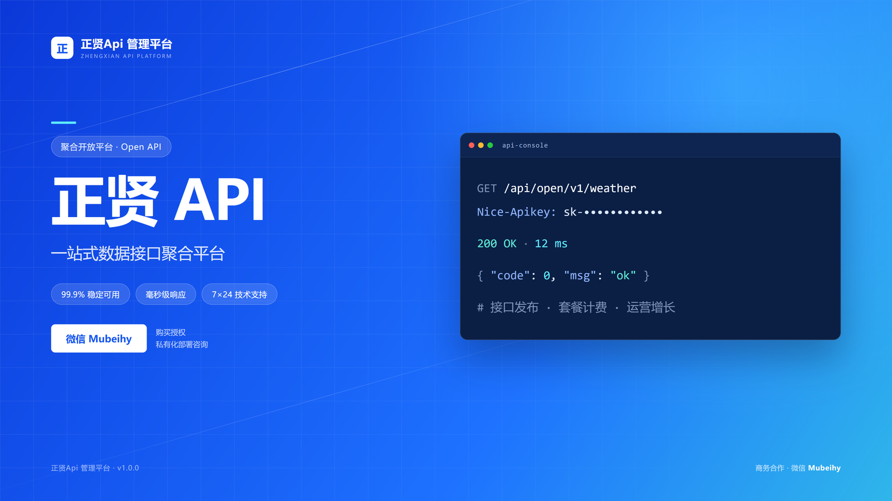
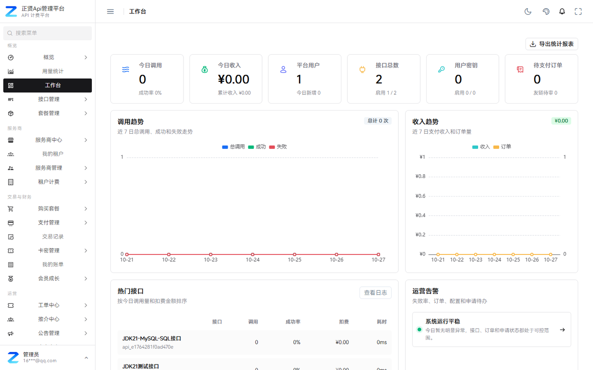
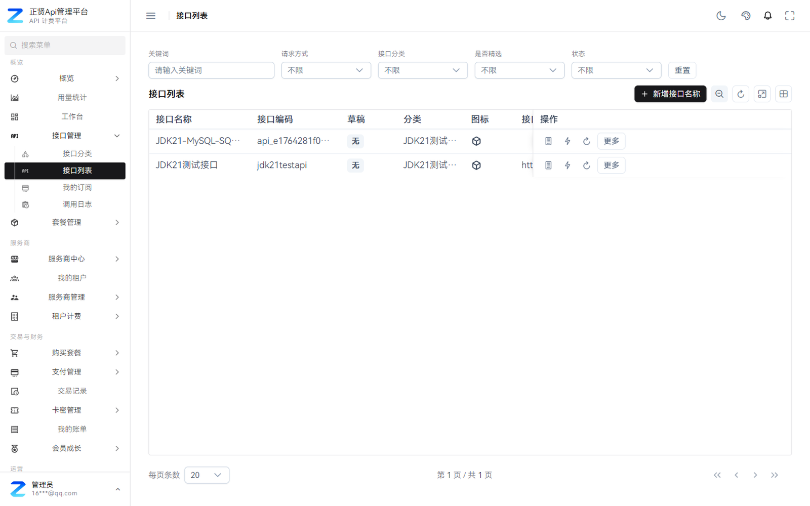
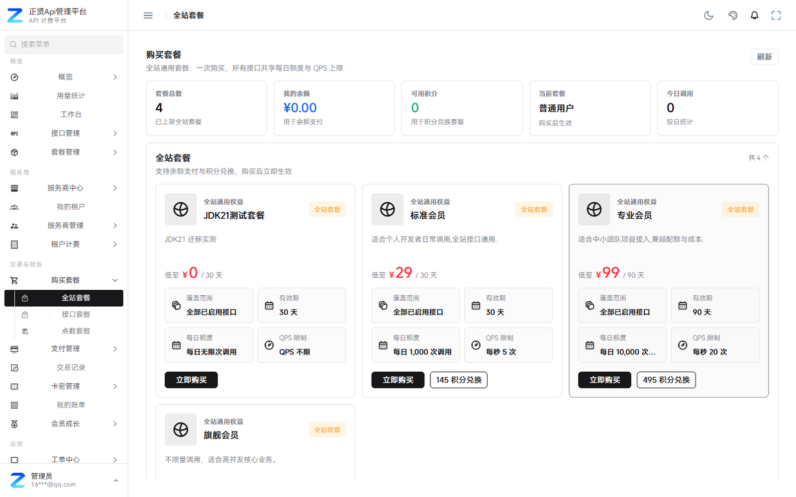
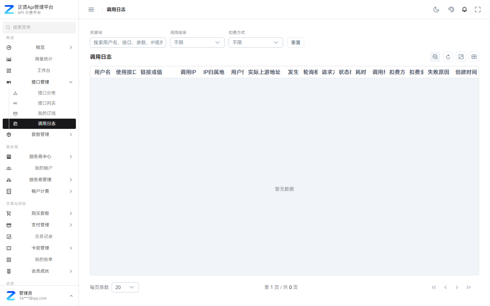
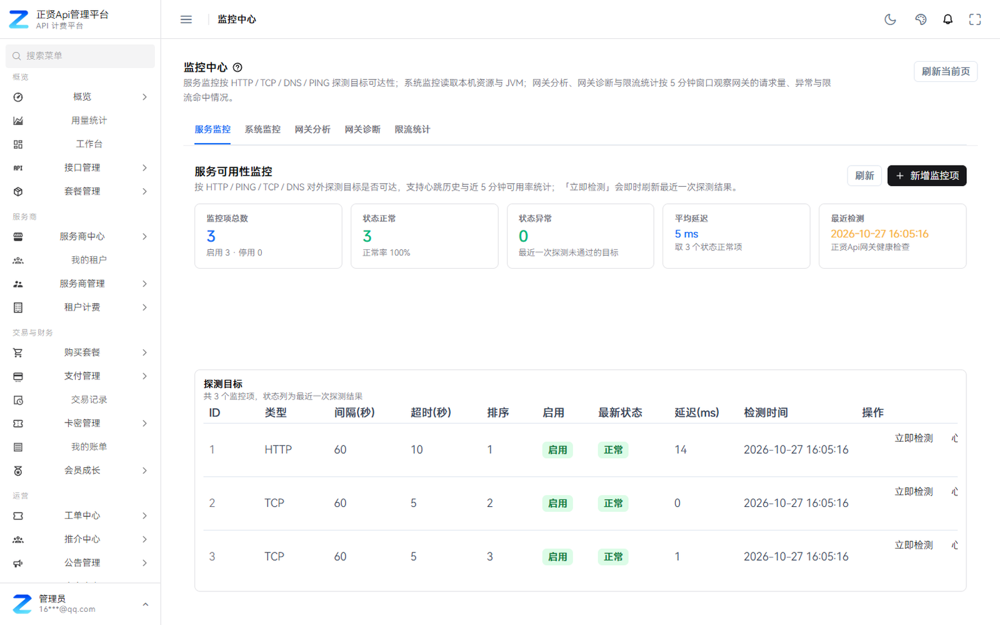
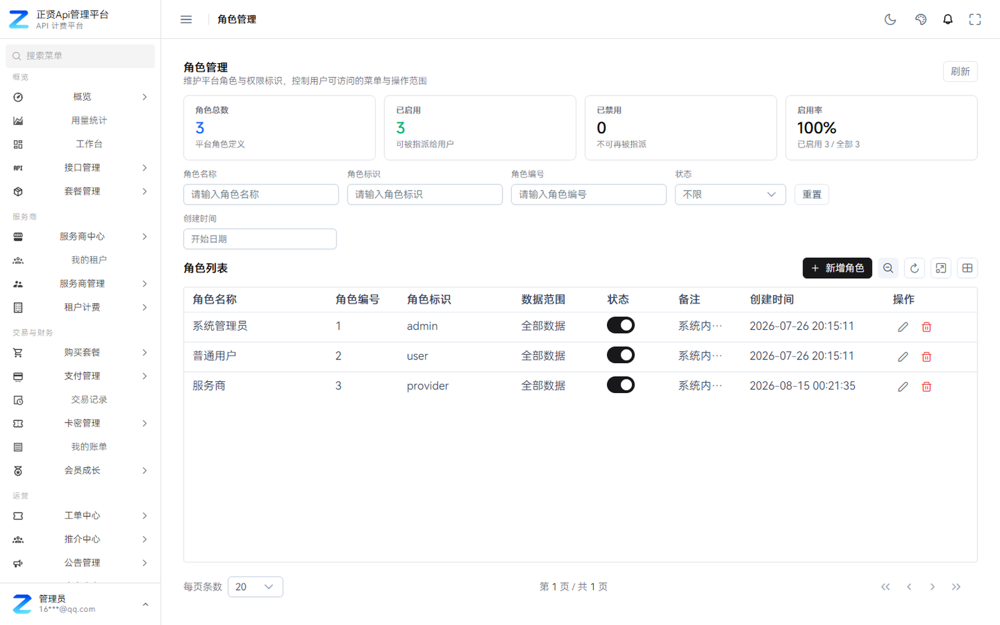
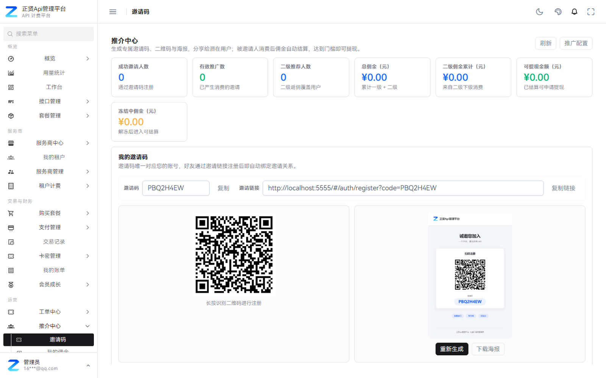
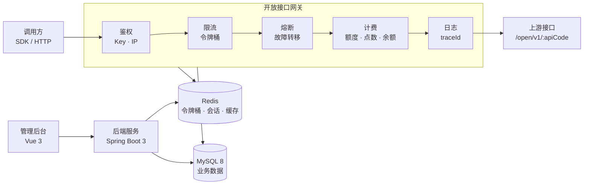

<p align="center">
  
</p>

<h1 align="center">正贤Api管理平台</h1>

<p align="center"><b>一套系统，跑通接口生意</b><br>
把接口发布、订阅调用、网关计费、账单结算、服务商提现与运营增长，收进同一个后台。</p>

<p align="center">
  
  
  
  
  
  
</p>

---

## 目录

- [项目简介](#项目简介)
- [能力总览](#能力总览)
- [功能详解](#功能详解)
  - [1. 账号与安全](#1-账号与安全)
  - [2. 工作台与经营概览](#2-工作台与经营概览)
  - [3. 接口市场与接口文档](#3-接口市场与接口文档)
  - [4. 在线调试](#4-在线调试)
  - [5. API 密钥与 IP 白名单](#5-api-密钥与-ip-白名单)
  - [6. 开放接口网关](#6-开放接口网关)
  - [7. 调用日志与用量](#7-调用日志与用量)
  - [8. 套餐与计费](#8-套餐与计费)
  - [9. 服务商中心](#9-服务商中心)
  - [10. SQL-to-API 引擎](#10-sql-to-api-引擎)
  - [11. 支付与财务](#11-支付与财务)
  - [12. 运营与增长](#12-运营与增长)
  - [13. 平台管理](#13-平台管理)
- [界面预览](#界面预览)
- [系统架构](#系统架构)
- [技术栈](#技术栈)
- [角色与权限](#角色与权限)
- [快速开始](#快速开始)
- [配置说明](#配置说明)
- [交付形态](#交付形态)
- [授权与分发](#授权与分发)

---

## 项目简介

接口散在文档里、订单记在表格里、账单靠人工对、分成靠 Excel 算。当接口从十几个长到几百个，这套土办法就撑不住了。

**正贤Api管理平台** 是一套面向 API 服务商、企业开发者和平台运营方的多租户 API 聚合、计费与运营管理系统。它把下面这条链路打通成一个闭环：

```text
接口发布 → 上架审核 → 用户订阅 → 密钥调用 → 网关鉴权与计费 → 账单结算 → 服务商提现 → 运营分析
```

两种用法：

- **对外**：作为你的 API 开放平台，卖接口、卖套餐、拉服务商入驻、做分成结算。
- **对内**：作为企业的接口资产管理与计费中台，统一收口内部接口的调用、额度与成本。

私有化部署，交付形态是免 JDK 的原生可执行程序，2C4G 起步即可运行。

---

## 能力总览

| 模块 | 覆盖能力 |
| --- | --- |
| 账号安全 | 多方式登录、三种验证码、第三方 IdP、同端互斥、密码历史拦截、封禁与强制下线 |
| 工作台 | 余额/点数/积分/套餐、调用量与成功率、7 日趋势、热门接口、待办与告警 |
| 接口资产 | 发布、上下架、分类、版本、计费规则、文档、状态管理 |
| 开放网关 | 统一鉴权、令牌桶限流、熔断与故障转移、统一计费、全链路 traceId |
| 计费结算 | 三类套餐、四段扣费顺序、四种支付方式、订单退款对账、服务商分成提现 |
| 服务商 | 入驻审核、接口发布、收益与排行、对账导出、提现、工单 |
| SQL-to-API | 只读 SQL 发布为接口、参数解析、字段脱敏、灰度、Mock、自动文档与 SDK |
| 运营增长 | 积分、签到、等级、徽章、邀请返佣、卡密、优惠券、公告站内信、页面装修 |
| 平台管理 | 用户、角色、菜单、租户、站点、定时任务、监控告警、操作审计 |

---

## 功能详解

### 1. 账号与安全

**登录方式**

- 账号密码登录、邮箱登录、用户名登录三条入口，同一账号可任选。
- 记住账号、找回密码、注册全流程自带，无需二次开发。

**验证码体系**提供三种强度，按站点需要切换：

| 类型 | 说明 |
| --- | --- |
| 滑动验证 | 拖动拼图完成校验，对抗脚本提交 |
| 算术验证 | 随机算式，轻量但足够拦住普通爬虫 |
| PoW 工作量证明 | 客户端计算 token 换取通行，成本高、无感体验好 |

**第三方登录**：支持 GitHub、Gitee 等 IdP 绑定，用户可在个人中心绑定或解绑。

**会话安全**

- 同端互斥登录：同一账号在新设备登录后，旧会话立即失效。
- 会话活跃超时：长时间无操作自动登出，超时时长可配。
- 密码历史复用拦截：禁止改回最近使用过的旧密码。
- 密码 BCrypt 存储，不落明文。
- MFA 恢复码，用于二次验证丢失时找回。

**管理侧**

- 封禁 / 解封用户，封禁即时生效。
- 强制下线指定会话。
- 重置用户安全要求（例如强制重新设置密码）。
- 所有管理动作写入审计日志，保留操作前后数据快照。

---

### 2. 工作台与经营概览

登录后的默认落地页，一眼看清自己的盘子：

**资产区**

- 账户余额、点数、积分、当前套餐名称与有效期。
- 充值、卡密兑换快捷入口。

**运行区**

- 今日调用量、调用成功率、失败率。
- 接口总数、密钥数量。
- 近 7 日调用趋势曲线与收入趋势曲线。

**运营区**

- 热门接口排行（按调用量）。
- 待处理订单、待办工单、运营告警提醒。
- 接口、密钥、日志、套餐、充值等一键直达入口。

不同角色看到的工作台不同：管理员看全平台，开发者只看自己的数据，服务商看自己的接口与收益。

---

### 3. 接口市场与接口文档

**接口市场**

- 按关键词搜索，按请求方式（GET/POST/...）筛选，按分类浏览。
- 接口卡片直接展示：价格、上架状态、累计调用次数、所属服务商。
- 支持只看可用接口，未上架/已下架的自动隐藏。

**接口详情**

每个接口都有一份完整文档，接入前不用再问人：

- 接口地址与请求方式。
- 计费说明：按次、按套餐额度、按点数还是按余额。
- 请求参数表：字段名、类型、是否必填、示例值、说明。
- 返回字段表：字段名、类型、说明。
- 状态码表与错误示例。
- 请求与响应示例，可直接复制。

**双视图**

- 公开文档页：未登录也能看，适合对外宣传与搜索引擎收录。
- 控制台文档：登录后在控制台内查看，带「去调试」「创建密钥」直达按钮。

---

### 4. 在线调试

- 页面内直接填写 Params、Headers、Body，不用切到 Postman。
- 一键发送请求，实时返回：状态码、耗时、本次计费金额、响应体。
- 调试请求**同样经过网关鉴权、限流与计费链路**，所见即正式调用的真实行为。
- 便于开发者在正式接入前确认参数格式与返回结构，减少联调返工。

---

### 5. API 密钥与 IP 白名单

**密钥类型**

| 类型 | 用途 |
| --- | --- |
| 接口密钥 | 绑定单个接口，权限最小 |
| 全站密钥 | 可调用已订阅的全部接口 |

**密钥管理**

- 创建、启用、停用、重置、删除。
- 密钥仅在创建时完整展示一次，之后脱敏保存，后台只能看到前后几位。
- 每个密钥可单独配置来源 IP 白名单，限制调用来源。

**SDK**

- 支持下载多语言 SDK（含调用示例），把接入成本压到最低。
- SDK 与接口文档同源生成，接口变更后重新下载即可。

---

### 6. 开放接口网关

所有对外开放调用都要过这一道门，五个动作串成一条链：

```text
鉴权 → 限流 → 熔断 → 计费 → 日志
```

**统一鉴权**

- 校验密钥有效性、用户状态（是否封禁）、接口状态（是否上架）、授权范围。
- 校验来源 IP 是否在白名单内。

**统一限流**

- 基于 Redis Lua 的令牌桶算法，原子操作，多实例部署也不会超发。
- 支持按用户、IP、密钥三个维度分别限流。
- 套餐的 QPS 上限与每日额度在这里生效。

**熔断与故障转移**

- 上游异常时快速失败，避免拖垮整个网关。
- 支持切换到备用节点。
- 请求体大小限制、IP 黑名单在入口拦截。

**统一计费**

- 按次、按套餐额度、按点数、按余额扣减，顺序见[套餐与计费](#8-套餐与计费)。
- 扣费与调用在同一次事务链路内完成，不重复扣、不漏扣。

**全链路 traceId**

- 每次调用生成唯一 traceId，从入口贯穿到上游。
- 调用日志可据 traceId 精确追溯。

**缓存一致性**：接口配置变更后自动清理网关缓存，改配置不用重启。

---

### 7. 调用日志与用量

**日志字段**

每次调用记录：调用用户、接口、调用 IP、状态码、耗时、扣费方式、扣费金额、失败原因、traceId、调用时间。

**查询与筛选**

- 按调用结果（成功/失败）筛选。
- 按扣费方式筛选。
- 按时间范围筛选。
- 支持分页与导出。

**用量分析**

- 用量统计：按日/周/月汇总调用量。
- 接口排行：哪些接口在被高频调用。
- 趋势分析：调用量与失败率的时间曲线。

**数据隔离**：管理员可查看全平台调用情况，开发者与服务商只能看到自己的数据。

---

### 8. 套餐与计费

平台提供三类套餐，覆盖不同付费习惯：

| 类型 | 适用场景 | 规则 |
| --- | --- | --- |
| 全站套餐 | 高频、多接口的团队 | 一次购买，全部接口共享每日额度与 QPS 上限 |
| 接口套餐 | 只需要某一两个接口 | 针对单个接口配置规格、额度与有效期 |
| 点数套餐 | 低频、偶发调用 | 先买点数，按次抵扣，不占用额度 |

**扣费顺序**（四段依次判定，用完才进入下一段）：

```text
会员套餐 → 接口套餐 → 点数 → 余额
```

**支付方式**

- 余额支付
- 支付宝
- 微信支付
- 积分兑换

**订单与生效**

- 订单状态可查，套餐购买后自动生效。
- 有效期独立计算，到期自动失效。
- 后台可配置套餐规格、额度、价格、上下架状态。

---

### 9. 服务商中心

让第三方服务商自己上架接口、自己拿钱，平台只做规则与结算。

**入驻**

- 提交入驻申请：店铺名称、简介、联系方式、申请理由。
- 平台审核，通过后开通服务商权限。

**接口经营**

- 发布接口，配置分类、计费规则、上下架状态。
- 管理自己名下的全部接口与版本。
- 查看每个接口的调用量与流水。

**收益与结算**

- 查看调用量、流水、平台抽成、净收益。
- 按日查看收益趋势与接口排行。
- 导出对账单（对账凭证）。
- 提交提现申请，平台审核后打款。

**工单**

- 服务商工单：受理、回复、解决、转交平台。
- 平台侧有对应的服务商工单管理页。

---

### 10. SQL-to-API 引擎

面向服务商的低代码接口生产能力：把内部数据库表快速发布成受控接口，不用写一行 Java。

**生产流程**

1. 选择数据源（支持动态数据源与连接池管理，密码加密存储）。
2. 编写**只读** SQL。
3. 系统自动解析参数，生成参数表。
4. 配置字段映射与脱敏规则。
5. 提交审核，通过后上架。

**只读安全校验**（四层拦截，防止把数据库写成筛子）

- 词法掩码：屏蔽注释、多语句等绕过手法。
- 语句白名单：只允许 SELECT 类只读语句。
- 关键字黑名单：拦截 INSERT/UPDATE/DELETE/DROP 等危险操作。
- `OUTFILE` / `DUMPFILE` 拦截：阻断导出文件类攻击。

**权限与脱敏**

- 表级 RBAC：控制能访问哪些表。
- 列级 RBAC：控制能访问哪些字段。
- 字段脱敏：手机号、身份证、邮箱等按角色下发不同结果。

**流量与发布控制**

- 令牌桶 QPS 限制，单接口独立配置。
- 灰度发布：先放小流量验证。
- Mock 降级：上游不可用时返回兜底数据。

**配套产出**

- 自动生成 OpenAPI 文档。
- 自动生成多语言 SDK。
- 版本、契约与审核状态全程可管，支持提交审核与上下架。

---

### 11. 支付与财务

**支付通道配置**

- 支付宝、微信支付、银联等通道接入。
- 维护商户号、AppID、密钥、证书、回调地址。
- 支付配置支持在线校验，配置错了当场能发现。
- 敏感字段加密保存，不落明文。

**订单与交易**

- 支付订单列表与详情。
- 退款处理。
- 交易记录查询。
- 对账（平台流水与实际收款核对）。

**充值与结算**

- 充值金额档位可配置（如 10/50/100/500 元）。
- 服务商结算：平台抽成、净收益计算。
- 提现审核与打款流程，全流程留痕。

---

### 12. 运营与增长

把「拉新—留存—裂变」做成可配置的功能，而不是写死的营销活动。

**积分体系**

- 充值兑换、消费获取、活动赠送。
- 积分明细可查。
- 积分可抵扣套餐费用（见[套餐与计费](#8-套餐与计费)）。

**签到体系**

- 连续签到累计奖励。
- 补签机制（消耗积分或次数）。
- 签到奖励规则可配。

**会员等级与成长值**

- 按成长值划分等级。
- 等级对应权益（折扣、额度、专属接口等）。
- 成长值来源可配。

**徽章成就**

- 条件类型：签到、累计调用、邀请人数、等级达成等。
- 达成后自动发放，个人中心展示。
- 徽章规则后台可视化配置。

**邀请返佣**

- 邀请码生成与绑定。
- 一级 / 二级返佣，比例可配。
- 佣金明细可查。
- 佣金可提现。

**卡密**

- 批量生成卡密。
- 用户在前台兑换。
- 支持批量导出。

**内容与消息**

- 公告、站内信、消息模板中心。
- 内容中心：站点公告、帮助文档、首页资讯、友情链接。
- 自定义页面与页面装修（拖拽式）。
- 优惠券、活动与运营规则配置。

---

### 13. 平台管理

**用户管理**

- 新增、编辑、删除用户。
- 角色分配。
- 余额调整（人工加减，留痕）。
- 封禁 / 解封、批量删除。
- 用户编辑弹窗内可直接查看该用户的订单、日志、密钥。

**角色与菜单**

- 角色权限配置。
- 菜单树管理，支持拖拽排序。
- 按钮级授权：同一个页面，不同角色看到的操作按钮不同。

**租户管理**

- 租户信息维护。
- 租户套餐与资源配额。
- 多租户数据隔离（用户、服务商、接口、订单、账单均带租户维度）。

**站点配置**

- 站点名称、Logo、联系方式、备案信息。
- 顶部导航配置。
- 首页内容与页面装修。

**定时任务**

- 任务编排（Cron 表达式）。
- 执行记录查看。
- 失败重试。

**监控中心**

- HTTP / TCP / DNS / PING 四类可用性探测。
- 主机资源监控（CPU、内存、磁盘）。
- 探测周期与超时可配。
- 手动触发即时检测。

**告警中心**

- 通知渠道配置（站内、邮件、Webhook 等）。
- 告警规则：阈值、触发条件、通知对象。
- 告警记录与静默管理。

**操作日志**

- 管理端操作全量审计。
- 记录操作人、IP、耗时。
- 保留操作前后数据快照，可对比。

---

## 界面预览

| 工作台 | 接口管理 |
| --- | --- |
|  |  |

| 套餐与计费 | 调用日志 |
| --- | --- |
|  |  |

| 监控中心 | 角色权限 |
| --- | --- |
|  |  |

| 邀请返佣 |
| --- |
|  |

---

## 系统架构



**运行结构**

- 管理后台与开放接口共用一套后端服务，默认监听 `8080`，上下文路径 `/api`。
- 开放接口对外路径为 `/open/v1/{apiCode}`，由 Nginx 反向代理到后端 `/api/open/`。
- 前端为纯静态资源，部署在 Nginx 站点根目录。
- MySQL 保存业务数据；Redis 承载验证码、会话、限流令牌桶、额度与缓存。

**权限模型**：用户 → 角色 → 菜单 → 资源，四层。菜单可见性由角色绑定，接口与数据访问由资源级过滤器校验，关键操作写入审计日志。

---

## 技术栈

| 层级 | 选型 |
| --- | --- |
| 前端 | Vue 3 · Vben Admin v5 · Ant Design Vue · PrimeVue · VXE Table · pnpm monorepo |
| 后端 | Spring Boot 3 · Java 21 · MyBatis-Plus · JdbcTemplate |
| 数据 | MySQL 8 · Redis 6+ |
| 网关 | 平台自建开放接口网关（鉴权 / 限流 / 熔断 / 计费） |
| 交付 | GraalVM Native Image，免安装 JDK |

---

## 角色与权限

| 角色 | 主要诉求 | 平台提供的能力 |
| --- | --- | --- |
| 平台运营管理员 | 管理用户、审核接口、配置站点与支付、查看经营数据 | 用户与角色权限、菜单管理、接口审核、站点配置、支付配置、订单与财务、监控告警、审计日志 |
| API 服务商 | 发布接口、获取调用量与收益、处理售后 | 入驻、接口发布与上下架、SQL 接口配置、收益统计、对账单导出、提现、服务商工单 |
| 企业开发者 | 快速接入稳定接口、控制成本与权限 | 接口市场、接口文档、在线调试、API 密钥、IP 白名单、多语言 SDK、套餐购买、调用日志 |
| 个人开发者 | 低成本试用与按需付费 | 注册登录、试用套餐、余额与点数支付、积分兑换、调用明细与账单 |

---

## 快速开始

### 环境要求

| 项目 | 要求 |
| --- | --- |
| 系统 | Linux x86_64（glibc 2.17–2.31：CentOS 7/8、Ubuntu 18.04/20.04、Debian 10/11） |
| 内存 | 2 GB 起（2C4G 可跑，常驻约 260–310 MB） |
| 数据库 | MySQL 8.x |
| 缓存 | Redis 6+ |
| 代理 | Nginx（宝塔站点） |

### 部署步骤

```bash
# 1. 建库并导入（205 张表 + 基础数据）
mysql -uroot -p zhengxian_api_billing < database/zhengxian-api.sql

# 2. 改配置：数据库与 Redis 连接（详见下方配置说明）
vi backend/config/application-local.yml

# 3. 赋执行权限
chmod +x backend/native/zhengxian-api backend/guard/zhengxian-guard

# 4. 启动（必须在 backend 目录，config/data/logs/uploads/guard 按工作目录解析）
cd backend && ./native/zhengxian-api --server.port=8080

# 5. 或交给 systemd 托管
cp zhengxian-api.service /etc/systemd/system/
systemctl daemon-reload && systemctl enable --now zhengxian-api
```

### Nginx 反向代理

```nginx
location /api  { proxy_pass http://127.0.0.1:8080/api;  }
location /open { proxy_pass http://127.0.0.1:8080/open; }
```

站点根目录指向 `frontend/`。

### 目录结构

```text
.
├── backend
│   ├── config/                 # application-local.yml：数据库 / Redis / JWT / AES
│   ├── native/zhengxian-api    # 原生可执行主程序（免 JDK）
│   ├── guard/zhengxian-guard   # 守护进程，提供敏感字段主密钥
│   ├── data/  logs/  uploads/  # 运行期数据，升级时保留
│   └── build.json
├── database/zhengxian-api.sql  # 205 张表结构与基础数据
├── frontend/                   # 静态资源，直接挂 Nginx
├── zhengxian-api.service       # systemd 单元
├── SHA256SUMS.txt              # 全量校验清单
└── VERSION.txt
```

### 升级

只替换可执行文件、封印文件、守护进程、构建指纹与前端目录；保留 `config/`、`data/`、`uploads/` 与数据库。

---

## 配置说明

`backend/config/application-local.yml` 关键字段：

| 字段 | 说明 |
| --- | --- |
| `spring.datasource.username` / `password` | MySQL 账号密码，部署前必须改 |
| `spring.datasource.url` | 库名非 `zhengxian_api_billing` 时取消注释并修改 |
| `spring.data.redis.host` / `port` | Redis 地址，默认 `127.0.0.1:6379` |
| `spring.data.redis.password` | Redis 有密码时必须填，否则登录验证码报 503 |
| `security.jwt.secret` | JWT 签名密钥（Base64），**必须替换为你自己的值** |
| `sqlapi.aes-key` | 数据源密码加密密钥（32 字节），**必须替换为你自己的值** |
| `authstation.domain` | 域名绑定，仅正式授权需要；试用用户留空 |

> 仓库内的 `security.jwt.secret` 与 `sqlapi.aes-key` 已脱敏为占位符，直接启动前请先生成你自己的密钥。

---

## 交付形态

| 包 | 适用环境 |
| --- | --- |
| native Linux legacy | glibc 2.17–2.31：CentOS 7/8、Ubuntu 18.04/20.04、Debian 10/11 |
| native Linux | glibc 2.34+：Ubuntu 22.04+、Debian 12+、RHEL 9+ |
| native Windows | Windows Server / Windows 10、11 |

原生版本不需要安装 JDK，后端进程常驻内存约 260–310 MB，适合 2C4G 起步的服务器。

---

## 授权与分发

本仓库内容以 **免费评估、学习与宣传** 目的公开。

- 部署前必须替换 `application-local.yml` 中的 `security.jwt.secret` 与 `sqlapi.aes-key`。
- 正式商用、二次分发与定制，请与作者联系确认授权。
- `SHA256SUMS.txt` 可用于校验发布包完整性。

---

<p align="center">如果你觉得这个项目有意思，欢迎 Star ⭐ 与 Issue 交流。</p>
