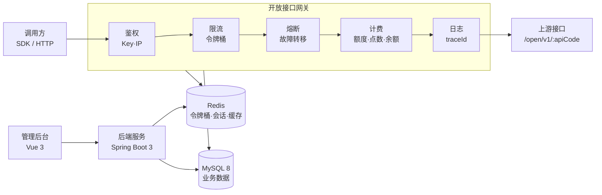

<div align="center">


# 正贤Api管理平台

**一套系统，跑通接口生意**

从接口发布到调用计费、结算提现、运营增长，把整条 API 商业闭环收进同一个后台。

[](#技术栈)
[](#技术栈)
[](#交付形态)
[](#技术栈)
[](#技术栈)
[](#授权与分发)

</div>

---

## 这是什么

一套面向 **API 服务商、企业开发者、平台运营方** 的多租户 API 聚合、计费与运营管理系统。

它解决的是同一个问题：接口散在文档里、订单记在表格里、账单靠人工对、分成靠 Excel 算。当接口数量从十几个长到几百个，这套土办法就撑不住了。

平台把这条链路打通成一个闭环：

```text
接口发布 → 上架审核 → 用户订阅 → 密钥调用 → 网关鉴权与计费 → 账单结算 → 服务商提现 → 运营分析
```

既可以作为对外的 **API 开放平台**，也可以作为内部的 **接口资产管理与计费中台**。支持私有化部署，交付形态是免 JDK 的原生可执行程序。

---

## 核心能力

<table>
<tr><td width="50%" valign="top">

**🧩 接口资产**
- 接口发布、上下架、版本与状态管理
- 分类、计费规则、服务商归属
- 接口文档：地址、参数、返回字段、状态码、示例
- 公开文档页 + 控制台文档双视图

**🔐 账号与安全**
- 账密 / 邮箱登录、滑动验证码、算术验证码、PoW 工作量证明
- 第三方 IdP 绑定（GitHub、Gitee）
- 同端互斥登录、会话滑动超时、密码历史拦截
- 封禁、强制下线、重置安全要求

**⚡ 开放接口网关**
- 统一鉴权：密钥、用户状态、接口状态、授权范围
- 统一限流：Redis Lua 令牌桶，用户 / IP / 密钥多维
- 熔断与故障转移、请求体大小限制、IP 黑名单
- 全链路 traceId，调用可追溯

</td><td width="50%" valign="top">

**💰 计费与结算**
- 全站套餐 / 接口套餐 / 点数套餐三类
- 扣费顺序：会员套餐 → 接口套餐 → 点数 → 余额
- 余额、支付宝、微信、积分兑换多通道
- 支付订单、退款、交易记录、对账

**🏪 服务商中心**
- 入驻申请与审核
- 发布接口、配置分类与计费
- 调用量、流水、平台抽成、净收益
- 收益趋势、接口排行、对账单导出、提现申请
- 服务商工单：受理、回复、解决、转交

**📈 运营与增长**
- 积分、签到（连续/补签）、会员等级与成长值
- 徽章成就、邀请返佣（一级/二级）、卡密
- 公告、站内信、消息模板、内容中心
- 优惠券、活动、自定义页面装修

</td></tr>
</table>

---

## 界面预览

<table>
<tr>
<td width="50%"><br><sub><b>工作台</b> · 余额、点数、调用量、成功率、近 7 日趋势</sub></td>
<td width="50%"><br><sub><b>接口管理</b> · 上下架、状态、价格与分类</sub></td>
</tr>
<tr>
<td width="50%"><br><sub><b>套餐与计费</b> · 全站 / 接口 / 点数三类套餐</sub></td>
<td width="50%"><br><sub><b>调用日志</b> · 状态码、耗时、扣费方式、金额</sub></td>
</tr>
<tr>
<td width="50%"><br><sub><b>监控中心</b> · HTTP / TCP / DNS / PING 探测</sub></td>
<td width="50%"><br><sub><b>角色权限</b> · 用户—角色—菜单—资源四层</sub></td>
</tr>
<tr>
<td width="50%"><br><sub><b>邀请返佣</b> · 邀请码、一级/二级返佣、佣金提现</sub></td>
<td width="50%"><sub>更多截图见 <code>frontend/</code> 实际部署效果</sub></td>
</tr>
</table>

---

## 架构



运行结构：

- 管理后台与开放接口共用一套后端服务，默认 `8080`，上下文路径 `/api`
- 开放接口对外路径 `/open/v1/{apiCode}`，由 Nginx 反代到后端 `/api/open/`
- 前端为纯静态资源，部署在 Nginx 站点根目录
- MySQL 存业务数据；Redis 承载验证码、会话、限流令牌桶、额度与缓存

---

## 技术栈

| 层级 | 选型 |
| --- | --- |
| 前端 | Vue 3 · Vben Admin v5 · Ant Design Vue · PrimeVue · VXE Table · pnpm monorepo |
| 后端 | Spring Boot 3 · Java 21 · MyBatis-Plus · JdbcTemplate |
| 数据 | MySQL 8 · Redis 6+ |
| 网关 | 平台自建开放接口网关（鉴权 / 限流 / 熔断 / 计费） |
| 交付 | GraalVM Native Image，免安装 JDK |

---

## 快速开始

### 环境要求

| 项目 | 要求 |
| --- | --- |
| 系统 | Linux x86_64（glibc 2.17–2.31 对应 CentOS 7/8、Ubuntu 18.04–20.04、Debian 10/11） |
| 内存 | 2 GB 起（2C4G 可跑） |
| 数据库 | MySQL 8.x |
| 缓存 | Redis 6+ |
| 代理 | Nginx（宝塔站点） |

### 部署步骤

```bash
# 1. 建库并导入（205 张表 + 基础数据）
mysql -uroot -p zhengxian_api_billing < database/zhengxian-api.sql

# 2. 改配置：数据库与 Redis 连接
vi backend/config/application-local.yml

# 3. 赋执行权限
chmod +x backend/native/zhengxian-api backend/guard/zhengxian-guard

# 4. 启动（必须在 backend 目录，config/data/logs/uploads/guard 按工作目录解析）
cd backend && ./native/zhengxian-api --server.port=8080

# 5. 或交给 systemd 托管
cp zhengxian-api.service /etc/systemd/system/
systemctl daemon-reload && systemctl enable --now zhengxian-api
```

Nginx 需要两条反代：

```nginx
location /api  { proxy_pass http://127.0.0.1:8080/api;  }
location /open { proxy_pass http://127.0.0.1:8080/open; }
```

站点根目录指向 `frontend/`。

### 目录结构

```text
.
├── backend
│   ├── config/                 # application-local.yml：数据库 / Redis / JWT / AES
│   ├── native/zhengxian-api    # 原生可执行主程序（330 MB，免 JDK）
│   ├── guard/zhengxian-guard   # 守护进程，提供敏感字段主密钥
│   ├── data/  logs/  uploads/  # 运行期数据，升级时保留
│   └── build.json
├── database/zhengxian-api.sql  # 205 张表结构与基础数据
├── frontend/                   # 静态资源，直接挂 Nginx
├── zhengxian-api.service       # systemd 单元
├── SHA256SUMS.txt              # 全量校验清单
└── VERSION.txt
```

### 升级

只替换可执行文件、封印文件、守护进程、构建指纹与前端目录；保留 `config/`、`data/`、`uploads/` 与数据库。

---

## 角色与权限

| 角色 | 关注点 | 平台提供 |
| --- | --- | --- |
| 平台运营管理员 | 用户、审核、支付配置、经营数据 | 用户与角色权限、菜单、接口审核、站点与支付配置、订单财务、监控告警、审计日志 |
| API 服务商 | 发布接口、拿收益、处理售后 | 入驻、接口发布与上下架、SQL 接口、收益统计、对账导出、提现、工单 |
| 企业开发者 | 稳定接入、控成本与权限 | 接口市场、文档、在线调试、密钥与 IP 白名单、多语言 SDK、套餐、调用日志 |
| 个人开发者 | 低成本试用、按需付费 | 注册、试用套餐、余额与点数支付、积分兑换、调用明细 |

权限体系为 **用户 → 角色 → 菜单 → 资源** 四层：菜单可见性由角色绑定，接口与数据访问由资源级过滤器校验，关键操作写入审计日志并保留前后数据快照。

---

## SQL-to-API 引擎

面向服务商的低代码接口生产能力：把内部数据库表直接发布成受控接口。

- 选择数据源，编写只读 SQL
- 自动解析参数、配置字段映射与脱敏
- 只读安全校验：词法掩码、白名单、关键字黑名单、`OUTFILE` 拦截
- 动态数据源与连接池，数据源密码加密存储
- 表级 / 列级 RBAC、字段脱敏
- 令牌桶 QPS、灰度发布、Mock 降级
- 自动生成 OpenAPI 文档与多语言 SDK
- 版本、契约与审核状态管理

---

## 交付形态

| 包 | 适用环境 |
| --- | --- |
| native Linux legacy | glibc 2.17–2.31：CentOS 7/8、Ubuntu 18.04/20.04、Debian 10/11 |
| native Linux | glibc 2.34+：Ubuntu 22.04+、Debian 12+、RHEL 9+ |
| native Windows | Windows Server / Windows 10、11 |

原生版本不需要 JDK，后端常驻内存约 260–310 MB。

---

## 授权与分发

本仓库内容以 **免费评估、学习与宣传** 目的公开。

- 仓库中的 `backend/config/application-local.yml` 已做脱敏处理，`jwt.secret` 与 `sqlapi.aes-key` 为占位符，**部署前必须替换为你自己的密钥**。
- 正式商用、二次分发与定制，请与作者联系确认授权。
- 仓库内 `SHA256SUMS.txt` 可用于校验发布包完整性。

---

<div align="center">

**正贤Api管理平台** · 接口生意的私有化底座

如果你觉得这个项目有意思，欢迎 Star ⭐ 与 Issue 交流。

</div>
